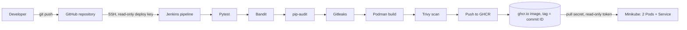

# SecureDeploy

A DevSecOps mini-project: a small Flask web application delivered through an automated CI/CD pipeline that tests it, scans it for security problems, builds a container image, publishes it to GitHub Container Registry, and runs it on Kubernetes.

## Abstract

SecureDeploy shows how security checks can be built into software delivery instead of added at the end. A Jenkins pipeline runs unit tests, static analysis (Bandit), dependency auditing (pip-audit), secret detection (Gitleaks), image building (Podman) and image vulnerability scanning (Trivy) on every build, then publishes the scanned image to GHCR. The image is deployed by hand to a local Minikube cluster with hardened Pod settings.

## Problem statement

Teams often ship code without checking their own code, their libraries, their secrets or their container images for known weaknesses, and a vulnerability found late is expensive to fix. This project builds a small end-to-end pipeline that finds these problems automatically and stops the build when a fixable serious problem appears.

## Objectives

- Build a small Flask application with a health endpoint.
- Test it automatically with Pytest.
- Scan code, dependencies, secrets and the container image, and read the findings critically.
- Build a minimal, non-root container image with Podman.
- Run the checks in a Jenkins pipeline and publish the image to GHCR with a commit-based tag.
- Deploy it to Kubernetes with health probes, resource limits and a hardened security context.
- Document what was verified and what was not.

## Architecture



The deployment to Kubernetes is done manually with `kubectl`. It is not a pipeline stage.

## Technologies

| Technology | Purpose |
|---|---|
| Python 3, Flask, gunicorn | Application and production web server |
| Pytest | Automated tests |
| Bandit | Static security analysis of Python code |
| pip-audit | Known-vulnerability check of dependencies |
| Gitleaks | Secret detection in files and Git history |
| Podman (rootless) | Building and running containers |
| Trivy | Container image vulnerability scanning |
| Jenkins 2.580.2 LTS | CI/CD pipeline |
| GitHub, GHCR | Source hosting and image registry |
| Kubernetes (Minikube) | Running the application |

## Repository structure

```
app/                  Flask application (factory + routes)
tests/                Pytest tests
k8s/                  Kubernetes Deployment and Service
docs/                 Trivy report, restart checklist, screenshots
Dockerfile            Container recipe
Jenkinsfile           Pipeline definition
requirements.txt      Pinned runtime dependencies
requirements-dev.txt  Pinned development and security tools
run.py                Entry point
```

## Application

- `/` returns a short HTML page.
- `/health` returns `{"application":"SecureDeploy","status":"healthy"}`, which Kubernetes uses for its readiness and liveness probes.
- The app uses a factory function (`create_app`) and a Blueprint, so tests can build a clean copy.
- Debug mode is off, and the local run script binds to `127.0.0.1`.

## Testing

```bash
pip install -r requirements-dev.txt
pytest -v
```

Three tests check the home page, the health status code and the health response body. All pass.

## Security scanning

```bash
bandit -r app run.py
pip-audit -r requirements.txt
gitleaks git --redact -v .
```

- Bandit found no issues in the 21 lines of application code.
- pip-audit found no known vulnerabilities in the pinned runtime dependencies at the time of the run.
- Gitleaks found no leaks in the commit history.
- Dependencies are pinned to exact versions, including the libraries Flask pulls in.

"No findings" means no known problems matched each tool's rules. It does not mean the software is secure.

## Container build

The image uses `python:3.12-slim` and:

- upgrades the Debian packages at build time,
- installs only the pinned runtime requirements, then removes pip,
- runs gunicorn as a non-root user (UID 10001) with the control socket disabled,
- is limited by `.dockerignore`, so tests, docs, Git data and key files are not copied in.

```bash
podman build -t localhost/securedeploy:dev .
podman run -d --name securedeploy-test -p 127.0.0.1:5000:5000 localhost/securedeploy:dev
curl -i http://127.0.0.1:5000/health
```

### Trivy results

Trivy v0.76.2 scans the image. The pipeline fails on HIGH or CRITICAL findings that have a fix available, and that gate passes.

- 47 HIGH findings (rows) remain in Debian base-image packages. None has an upstream fix yet.
- The full report is in `docs/trivy-report.txt`. Many rows repeat the same vulnerability across related packages.
- An earlier scan found fixable issues (zlib, apt, pcre2) and a finding from a copy of setuptools bundled inside pip. Upgrading packages and removing pip from the final image cleared them.

## Jenkins pipeline

Stages, in order: Checkout, Install dependencies, Unit tests, Bandit scan, Dependency audit, Secret scan, Build image, Trivy scan, Publish to GHCR. Any failing stage stops the build, and nothing is published unless the earlier stages pass.

- Jenkins reads the `Jenkinsfile` from this repository over SSH with a read-only deploy key.
- Jenkins runs as the local user on `127.0.0.1:8080`, so it can use the same rootless Podman.
- Images are tagged with the 7-character commit ID. There is no `latest` tag.

## GHCR publishing

The image is published as `ghcr.io/shreeshanth1112/securedeploy:<commit-id>` and the package is private. The token is stored in Jenkins Credentials, masked in logs, and passed to Podman through stdin. A short-lived temporary login file is deleted after each build.

## Kubernetes deployment

`k8s/deployment.yaml` and `k8s/service.yaml` define:

- a `securedeploy` namespace, 2 replicas, readiness and liveness probes on `/health`,
- CPU and memory requests and limits,
- a Pod security context: non-root user, no privilege escalation, all capabilities dropped, read-only root filesystem, a writable `/tmp` only,
- an image pull secret built from a separate read-only token.

```bash
kubectl create namespace securedeploy
kubectl apply -f k8s/
kubectl -n securedeploy rollout status deployment/securedeploy
kubectl -n securedeploy port-forward svc/securedeploy 8081:80
curl -i http://127.0.0.1:8081/health
```

## Results

| Check | Result |
|---|---|
| Pytest | 3 passed |
| Bandit | No issues |
| pip-audit | No known vulnerabilities |
| Gitleaks | 16 commits scanned, no leaks |
| Trivy gate (HIGH/CRITICAL with a fix) | Passed |
| Jenkins build #2 | SUCCESS |
| GHCR | Image published, package private |
| Kubernetes | 2/2 Pods ready, `/health` returned 200 |
| Image identity | Image ID in the cluster matched the ID built and scanned by Jenkins (first 13 characters) |
| Pod hardening | Non-root user confirmed, writes to `/app` rejected, `/tmp` writable |

### Screenshots


## Limitations

- The deployment to Kubernetes is manual. The pipeline stops at GHCR.
- Jenkins runs as a normal user on one laptop. A shared server should use a dedicated service account and isolated build agents.
- 47 HIGH Debian base-image findings have no available fix, and MEDIUM and LOW findings were not reviewed one by one.
- The GHCR token is a classic personal access token, which cannot be limited to a single package. It is short-lived and stored only in Jenkins.
- Kubernetes Secrets are base64-encoded, not encrypted.
- Image builds can reuse cached layers, so a new Debian patch may not be picked up until the cache is refreshed.
- Tests run on Python 3.14 in Jenkins and on the laptop, while the container uses Python 3.12.
- The cluster is a single-node Minikube, so the two replicas share one machine.
- `kubectl` 1.35 was used against a 1.37 cluster, which is outside the officially supported version skew.
- This repository is public. It contains no credentials, only credential names.

## Future enhancements

- Add a deploy stage to the pipeline.
- Build with `--pull=newer --no-cache`, pin the base image by digest, and rebuild regularly.
- Generate an SBOM and sign images.
- Pin dependency hashes, and add automatic dependency updates.
- Scan the Kubernetes manifests, and add NetworkPolicies and an Ingress.
- Run Jenkins in a container or on a dedicated agent, and trigger builds with a webhook.
- Use a secrets manager instead of plain Kubernetes Secrets.

## Restarting the environment

See `docs/restart-checklist.txt`.
